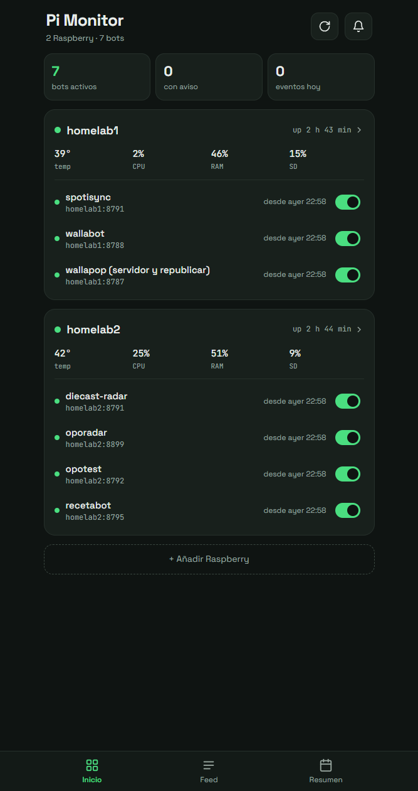
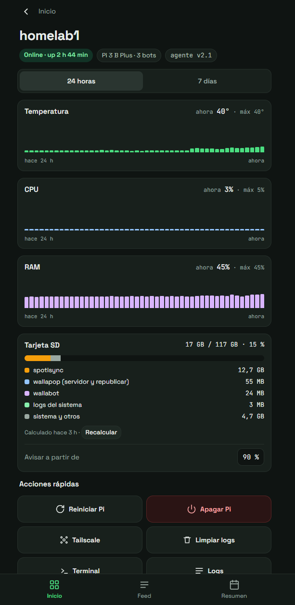
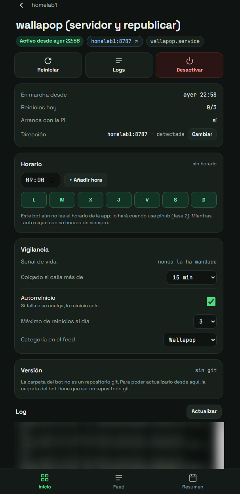

# Pi Monitor

Sistema de **monitorización y control de Raspberry Pi** desde el móvil. Un agente ligero en cada Pi expone su estado y el de los servicios que aloja, y una app Android propia lo muestra todo y envía avisos nativos cuando algo falla.

## Qué hace

- **Estado de cada Pi**: CPU, temperatura, memoria, disco, voltaje y tiempo encendida, con gráficas de 24 horas y 7 días.
- **Gestión de servicios**: detecta los bots y servicios de cada Pi, su puerto y su estado; permite arrancarlos, pararlos y reiniciarlos desde el móvil.
- **Vigilancia activa**: detecta servicios caídos o colgados y los reinicia automáticamente con un límite de intentos.
- **Avisos**: servicio que falla, bajo voltaje, temperatura alta, disco lleno, Pi que se reinicia o deja de responder. Si no responde ninguna, avisa de posible corte de luz o de internet en casa.
- **Sin falsas alarmas**: distingue entre "la Pi no responde" y "el móvil no tiene conexión con la VPN", y recupera los avisos perdidos al reconectar.
- **Hub de servicios**: feed de eventos y resumen diario de todos los servicios alojados.

## Capturas

<table>
  <tr>
    <td align="center"></td>
    <td align="center"></td>
    <td align="center"></td>
  </tr>
  <tr>
    <td align="center">Inicio</td>
    <td align="center">Detalle de una Pi</td>
    <td align="center">Detalle de un servicio</td>
  </tr>
</table>

## Arquitectura

```
 Raspberry Pi 1           Raspberry Pi 2
 ├─ pi-agent (Python)     ├─ pi-agent (Python)
 │  métricas, systemd,    │  ...
 │  eventos, API HTTP     │
 └─ servicios/bots        └─ servicios/bots
          ▲                        ▲
          └─────── Tailscale ──────┘
                      │
            App Android (Kotlin)
            sondeo, avisos, control
```

## Tecnologías

- **Agente**: Python 3 con solo biblioteca estándar (`http.server`, `subprocess`, `hmac`), pensado para consumir lo mínimo en una Pi 3.
- **Sistema**: integración con `systemd` y métricas del sistema Linux.
- **Seguridad**: autenticación por token y acceso solo a través de VPN (Tailscale).
- **App**: Android nativo en Kotlin, con servicio persistente y arranque automático.
- **CI/CD**: GitHub Actions compila la APK en cada push.

## Estructura

```
agente/         agente que se instala en cada Pi (+ instalador y servicio)
app-android/    app Android
.github/        compilación de la APK
```

## Puesta en marcha

```bash
sudo bash agente/install.sh   # en cada Raspberry Pi
```

La guía completa está en [INSTALACION.md](INSTALACION.md).
